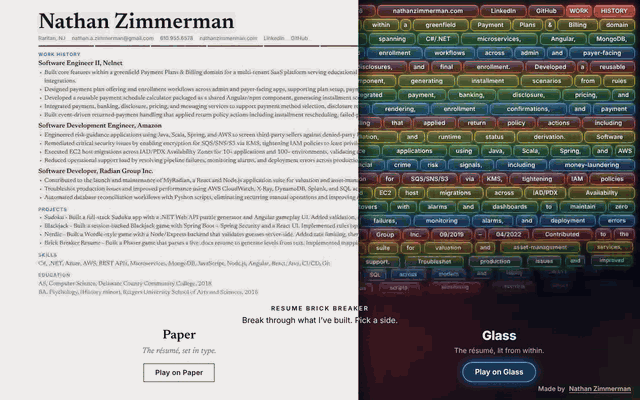
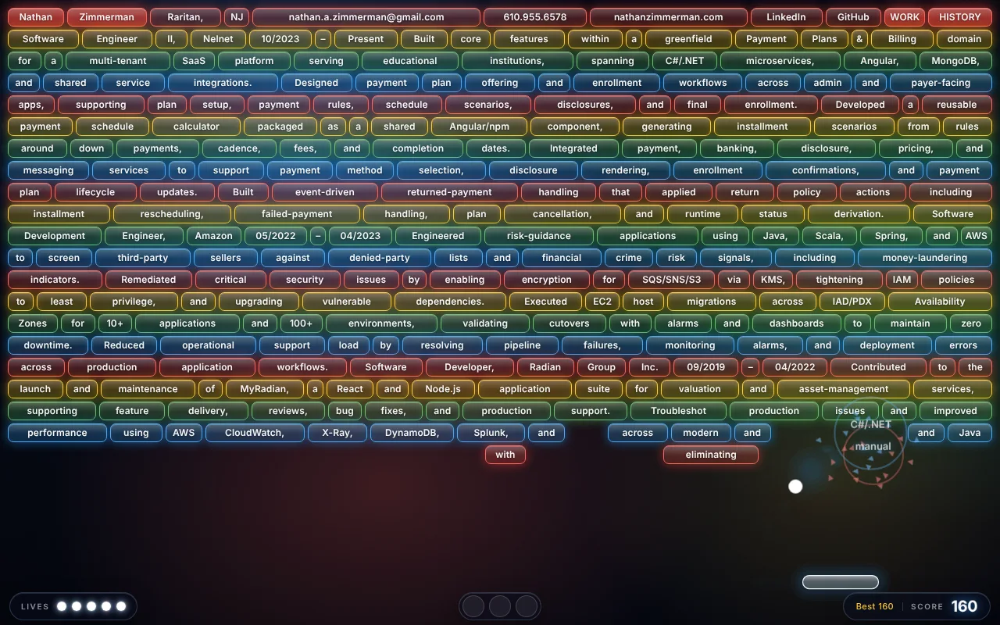
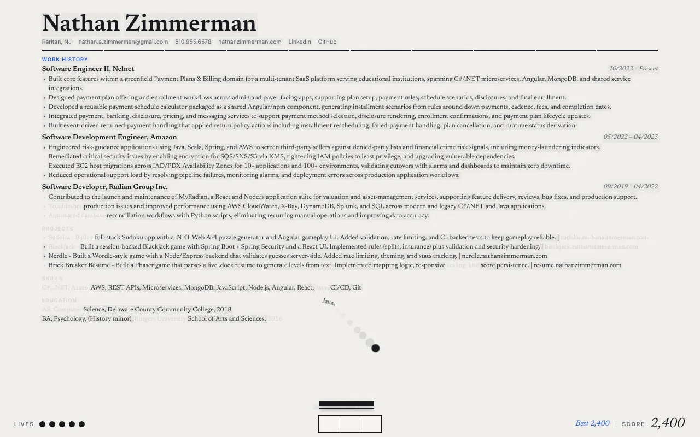
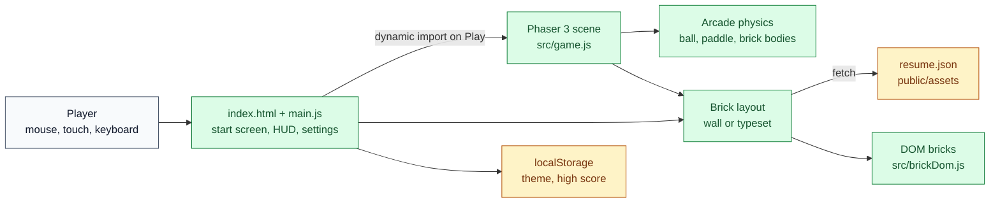

# Brick Breaker Resume

A Phaser 3 browser game that turns a Word résumé into a Brick Breaker level: every word is a brick, and you play through a career one bounce at a time.

[](https://github.com/natezimm/brick-breaker-resume/actions/workflows/ci.yml)
[](LICENSE)
[](https://resume.nathanzimmerman.com)



**Play it at [resume.nathanzimmerman.com](https://resume.nathanzimmerman.com).**

| Glass (dark)                                                                            | Paper (light)                                                                                                       |
| --------------------------------------------------------------------------------------- | ------------------------------------------------------------------------------------------------------------------- |
|  |  |

## What it does

- **Your résumé is the level.** A build step parses the `.docx` into words, and each word becomes a brick sized to fit it. Higher rows score more.
- **Two complete looks.** Glass lays the words out as a wall of glowing bricks. Paper typesets the résumé as a printed page, where each broken word leaves a faint impression. The start screen shows both, split down the middle; drag or hover the seam, then pick a side.
- **Switch looks mid-game.** Changing the theme in settings re-lays the page in the other look and keeps every word you have already broken.
- **Settings that pause the game.** Ball and paddle colors with a live preview, paddle width, ball speed and sound.
- **Lives, score and a saved best.** The HUD shows a pip per life, the score and your best, which persists in the browser. Pause with the button or `P`, and play resumes after a countdown.
- **Mouse and touch.** Works on desktop and phones, and the layout follows window resizes.

## Engineering highlights

- **Résumé as build-time data.** [`scripts/generate_resume_json.js`](scripts/generate_resume_json.js) converts the `.docx` with Mammoth and JSDOM into `public/assets/resume.json`, and the `predev` and `prebuild` hooks rerun it, so the game always matches the document and never ships a parser to the browser.
- **DOM bricks, Phaser physics.** Each brick is a DOM element so the type stays crisp at any size, paired with an invisible static physics body in Phaser ([`src/bricks.js`](src/bricks.js)). The canvas is transparent and only draws the ball, paddle and their trails.
- **Two layouts, one word index.** The wall ([`src/brickLayout.js`](src/brickLayout.js)) and the typeset page ([`src/typeset.js`](src/typeset.js)) give every word the same `wordIndex`, so a mid-game theme switch rebuilds only the remaining bricks from `state.brokenWords`. The typeset layout measures words with the same font strings the DOM renders, using a self-hosted Newsreader so the Content Security Policy stays on `'self'`.
- **Fast first paint.** Phaser is a separate chunk loaded with a dynamic `import()` only after a look is chosen ([`main.js`](main.js)), and booting it waits for the sweep animation so the transition never stutters.
- **Defensive by default.** Text is rendered with `textContent` only, stored themes and high scores are validated before use, and only allowlisted asset paths are fetched.

## Architecture



[`docs/architecture.md`](docs/architecture.md) has the system context, the résumé-to-bricks sequence and the delivery pipeline.

## Tech stack

| Area     | Tools                                                     |
| -------- | --------------------------------------------------------- |
| Game     | Phaser 3 (Arcade physics), vanilla JavaScript modules     |
| Build    | Vite, Mammoth and JSDOM for the résumé parser             |
| Styling  | Plain CSS with design tokens, self-hosted Newsreader      |
| Tests    | Jest with jsdom, Playwright (desktop and mobile Chromium) |
| Quality  | ESLint, Prettier                                          |
| Delivery | GitHub Actions, rsync to a GCP VM behind nginx            |

## Run it locally

You need Node.js 22 (see `.nvmrc`).

```bash
git clone https://github.com/natezimm/brick-breaker-resume.git
cd brick-breaker-resume
npm ci
npm run dev        # http://localhost:8080
```

For a production build, run `npm run build` and then `npm start` to preview `dist/`.

Or run the built site in Docker: `docker compose up --build` serves it at http://localhost:8080.

### Using your own résumé

Replace `public/assets/Nathan Zimmerman Resume.docx` with your own `.docx` under the same name. `npm run dev` and `npm run build` regenerate `public/assets/resume.json` from it, or run `npm run generate:resume` yourself. Edit the document or the parser rather than the JSON, which is overwritten on the next run.

## Tests and quality

`npm run quality` is the gate CI runs on every pull request and push to `main`:

| Command                 | Checks                                                                          |
| ----------------------- | ------------------------------------------------------------------------------- |
| `npm run format:check`  | Prettier formatting                                                             |
| `npm run lint`          | ESLint                                                                          |
| `npm run test:coverage` | Jest units, failing below 90% lines, 85% statements and functions, 80% branches |
| `npm run test:e2e`      | Playwright against the production build, at desktop and phone sizes             |

Use `npm test` for a quick unit run, and `npm run test:e2e:headed` or `npm run test:e2e:ui` to debug the browser tests. Install the browser once with `npx playwright install chromium`.

## Deployment

The `deploy` job in [`.github/workflows/ci.yml`](.github/workflows/ci.yml) runs only for pushes to `main` after the quality gate passes. It downloads the built `dist/` artifact, `rsync`s it to `/var/www/brick-breaker/` on a GCP VM, where nginx serves it at [resume.nathanzimmerman.com](https://resume.nathanzimmerman.com), and then checks that the site answers.

It needs these repository secrets: `GCP_SSH_KEY`, `GCP_HOST`, `GCP_USER`, `GCP_KNOWN_HOSTS` and `APP_DOMAIN`. `GCP_KNOWN_HOSTS` pins the VM's SSH host key as one `known_hosts` line (for example `203.0.113.10 ssh-ed25519 AAAA...`) whose host matches `GCP_HOST`. The job refuses to connect when it is empty and uses `StrictHostKeyChecking yes`, so a missing or changed key stops the deploy.

## Project layout

```text
index.html, main.js     entry point, start screen and UI wiring
src/                    game scene, bricks, layouts, HUD, settings, state
styles/                 tokens, the two looks, components, fonts
scripts/                résumé .docx to JSON parser
public/assets/          résumé source and generated JSON, sounds
tests/                  Jest units
e2e/                    Playwright browser tests
docs/                   architecture and images
```

## Roadmap

- A typed schema for `resume.json` (JSDoc or a small TypeScript layer), so the parser and the layouts share one contract.
- A stricter split between rendering adapters and game rules.

## License

[MIT](LICENSE)
