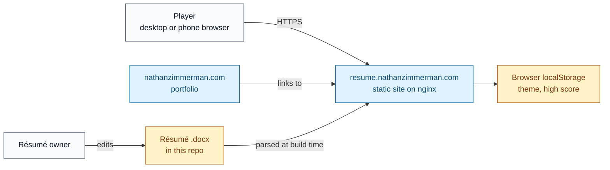
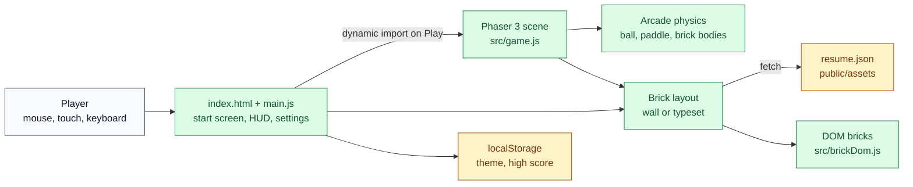
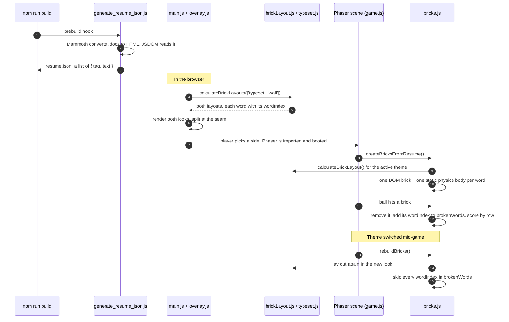
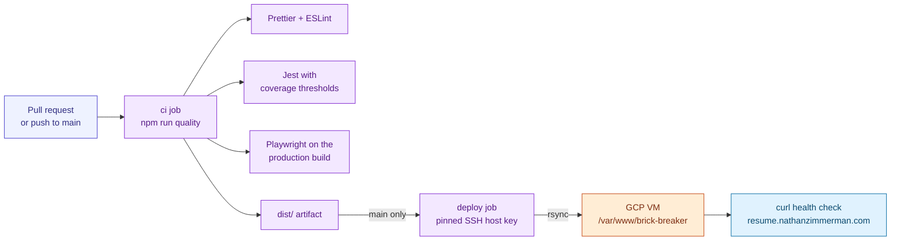

# Architecture

Brick Breaker Resume is a static Vite site. A build step turns the résumé `.docx` into `public/assets/resume.json`; in the browser, `main.js` draws the start screen from that data and loads Phaser 3 only once a player picks a look. There is no server-side code: nginx on a GCP VM serves the built `dist/` folder.

The diagrams use the shared palette from the portfolio's [workspace architecture](https://github.com/natezimm/nathanzimmerman.com/blob/main/docs/architecture.md), which also shows how this game fits among the other projects.

## System context

## Containers and runtime

Everything runs in the player's browser. The page owns the DOM (start screen, HUD, settings and the bricks themselves); Phaser owns physics and draws the ball, paddle and trails on a transparent canvas laid over the bricks.

## Résumé to bricks

The flow that carries the most design: one document becomes two complete layouts that agree on every word, so a theme switch mid-game keeps what the player has broken.

## Delivery pipeline

## Source boundaries

- `main.js` wires startup: theme, start screen, and the on-demand Phaser import.
- `src/game.js` is the scene lifecycle and gameplay; `src/state.js` holds per-scene state; `src/config.js` and `src/constants.js` hold configuration and each look's defaults.
- `src/brickLayout.js` (wall) and `src/typeset.js` (paper page) compute layouts; `src/brickDom.js` renders bricks for both the start screen and the game; `src/bricks.js` pairs them with physics bodies and handles hits.
- `src/ui.js`, `src/settings.js` and `src/overlay.js` are the DOM UI, settings modal and start screen.
- `scripts/` parses the résumé. It is CommonJS and runs only at build time.

## Quality gates

`npm run quality` runs Prettier, ESLint, Jest with coverage thresholds (`jest.config.cjs`), and Playwright against the production build at desktop and phone sizes. The Playwright web server runs `npm run build`, so the résumé parser runs too.

## Deferred follow-ups

Phaser module boundaries stay as they are for now. Later work can separate rendering adapters from game rules more strictly and add a typed schema for `resume.json`.
